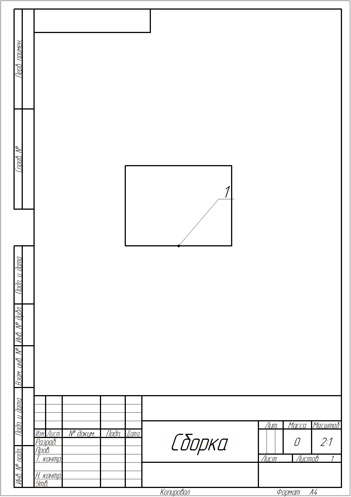
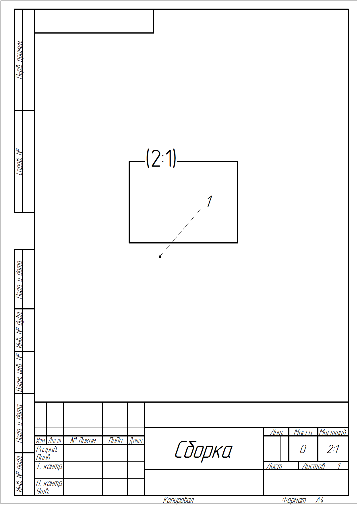

# Нативная синтетическая проверка: новая ревизия источника не исправила наконечник

Дата: 23.11.2026. Native КОМПАС v25, один STA worker за раз, после явной
передачи общей CAD-сессии. Созданы только новые synthetic files/GUID; материалы
и файлы изделий не использовались как геометрический fixture. Установленный
toolkit не обновлялся. Общая сессия освобождена после независимой финальной описи.

## Результат

**Оба варианта дали отрицательное следование:** обновление source под прежним
именем и bytecopy на новый revision path **до** изменения. В обоих случаях
материальная линия реально сместилась, tip остался в прежних координатах вида,
а exact/Valid base и действующий type12 сохранились. То же состояние прочитано
после Save и двух независимых RO-открытий. Unique-source-revision больше не
является непроверенным кандидатом для этого конкретного fixture/рецепта.

Это не универсальный диагноз КОМПАС, не проверка всех типов выносок и не
приёмка position/SP UUID интеграции. Испытывалась геометрическая связь одной
PositionLeader с literal position `1`. Автоматическое следование не принято.

## Контрольная геометрия и порядок

- Новый plate part: прямоугольник 32×24 мм, extrusion 6 мм, native volume
  4608 мм³. Part file остаётся immutable.
- Для каждого варианта — отдельная новая assembly с одной linked insertion,
  отдельный CDW, одна front projection scale 2 и одна PositionLeader.
- Выбрана нижняя горизонтальная материальная линия **из AssociationObjects
  точной вставки**. MainTopPart не запрашивался. Tip поставлен в середину линии.
- Связь: SetBaseObject(branch0, typed IDrawingObject, -1), own leader Update,
  exact/Valid GetBaseObject, native type12 Valid. Current setter не использован.
- Независимый source placement stimulus: (+7,+4,0) мм. Actual placement и Fixed
  считаны; применены только scoped view.Rebuild и own 2D RebuildDocument.
- Чтения выполнены в документированных -7 (view) и -2 (sheet) режимах. Native
  sheet witnesses сверены с measured XY/scale unrotated view: residual 0.
  Paper coordinates не выведены из предположения о смысле -1.
- Изменения начала вида не скрывались и не исправлялись вручную. На M1 tip
  сравнивался с действительным перемещением обоих концов material segment.

| Наблюдение на M1, sheet mm | Same filename | Unique revision |
|---|---:|---:|
| Material delta X/Y | +0.75566649 / +4 | +0.75566649 / +4 |
| Tip delta X/Y | -13.24433351 / -4 | -13.24433351 / -4 |
| Норма расхождения delta | 16.12451550 | 16.12451550 |
| Immediate follows | False | False |
| Saved RO cycle 1 / 2 follows | False / False | False / False |
| Base exact/Valid, type12 Valid | Да | Да |

В unique варианте r0 скопирован в r1 до редактирования. Для возврата создан r2
из r1 до обратной правки; byte SHA r0/r1 после этого остались прежними.
Пути источника и его фактические geometry/placement проверены после смены
ревизии. Промежуточные source revisions и все rejected artifacts сохранены.

## Возврат и незавершённый первый receipt

Первый same-filename run дошёл до M1, двух SavedRO подтверждений отказа, затем
вернул source placement M0 и сохранил результат. Его первая restored RO-проверка
остановилась на слишком сильном утверждении, что tip должен вернуться в прежнюю
**абсолютную** точку страницы. Сам вид был автоматически пересмещён. Поэтому
этот raw receipt честно остаётся `failed`, а полный цикл восстановления по нему
не объявлен успешным.

После чтения partial receipt отдельно закрыты только два оставшихся **собственных
RO** документа, по exact fresh reference/path/state и тому же process creation
identity. Cleanup не повторял никакую CAD-мутацию. Пять защищённых документов
не закрывались. Эта отдельная reconciliation имеет собственный receipt.

Второй unique-revision запуск использовал новый root/GUID и baseline; прежний
same-filename опыт не переигрывался. До M1 алгоритм создания/binding/измерения
не менялся. Исправлены разделение критериев возврата и bookkeeping cleanup.
В unique варианте два restored RO-цикла подтвердили M0/Fixed и исходное
**относительное** положение tip к материалу. Но absolute page position не
вернулась: tip и материал получили одинаковое общее смещение. Эти результаты
разделены; это не full page restoration PASS и не успех следования на M1.

## Визуальная проверка native export

Исходные PNG экспортированы из собственных CDW через native API5 raster export.
Их bytes не редактировались. Просмотрены baseline, M1 и restored изображения:
на M1 точка наконечника явно находится ниже материального контура. После
возврата она снова на контуре, но сам вид находится в другом месте листа.
Rebuild также добавил обозначение масштаба вида; это побочное изменение не скрыто.

| Baseline | После перемещения источника |
|---|---|
|  |  |

[Неизменённый restored PNG](images/leader-source-revision-restored.png).
PDF/export-package portability и внешний вид production не испытывались.

## Сохранность и ресурс

Перед созданием fixture заново обнаружены VM/process и реальные документы;
исторический PID не использовался как разрешение. Во время вызовов работал один
worker, защищённый mutex. Свежие guards до/после операций проверяли process
creation identity, точные baseline documents и полный набор own documents.

Независимый финальный attach-only collector увидел те же пять защищённых
видимых RO документов, Changed=False. Все synthetic документы закрыты;
owned_remaining=0. SHA/inventory 2330 файлов двух защищённых деревьев и 68
файлов package/SDK libraries, запечатанных harness, совпали до/после работы.
Не выполнялись Save/Rebuild/Close над защищёнными документами или global Rebuild.

## Воспроизведение и evidence

Экспериментальный harness:
[`native_owned_session.py`](../scripts/native_owned_session.py) и
[`validate_leader_source_revisions.py`](../scripts/validate_leader_source_revisions.py).
Он требует внешние configuration/handover receipts, existing interactive CAD,
новый native root и отдельную передачу ресурса. Не запускает CAD и не устанавливает
SDK. Native import только при явном запуске. Внешние пути/личные inventories
и product receipts не включены в публичный repository.

Private evidence сохранено в `cad-assistant/native-tests/`:

- `leader-source-revisions-a9613476fd9743a7830814e2d7b9e5aa`: discover, negative/partial
  run, scoped cleanup, native-copy и exact source-run scripts.
- `leader-source-revisions-38c57478df244c44a521bf600d15c8ea`: complete comparison
  с follows=False, independent final discover, native-copy, source-run scripts.

Source-run SHA обоих скриптов сверены с SHA, записанными исполнявшимся worker.
Первый source snapshot восстановлен из последующей редакции и проверен на
побайтовое совпадение с исходным receipt SHA; второй сохранён напрямую.
Current harness дополнительно архивирует source snapshot до начала новых запусков
и возвращает ненулевой exit code при ошибке. Raw receipt остаётся главным
источником статуса, а `complete_synthetic_comparison` означает завершение
**сравнения**, не passing dynamics.

Независимый offline пересчёт `leader_motion` подтвердил все шесть отрицательных
M1 observations из двух receipts. SHA трёх скопированных PNG каждого опыта
совпали с native export receipts. Основные шесть функций selection/readback/
measurement в source snapshots двух запусков совпали по AST.
18 новых offline проверок защищают отказ при foreign handle, process/document
drift, path/symlink escape, overlap с protected/installed trees, overwrite другого
файла и неоднозначный return-контракт SaveAs. Полный pytest: 812 passed,
5 прежних SWIG DeprecationWarnings; Ruff src/tests/scripts PASS.

После результата новые native опыты не запускались. Для дальнейшего поиска
нужен отдельный согласованный контроль штатной GUI-created association или
иной явно проверяемой точки/segment семантики; автоматическая подстановка
другого constraint enum и повтор этого же revision-рецепта не обоснованы.
